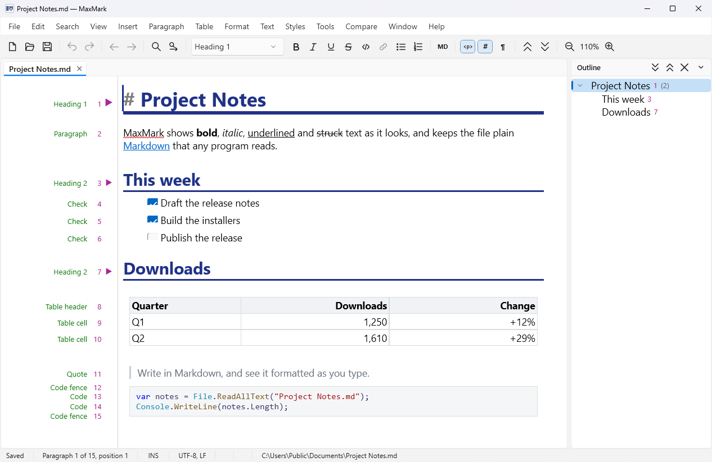
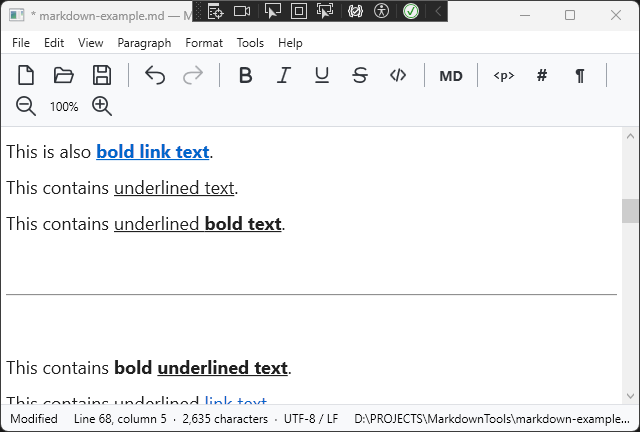

# MaxMark

**MaxMark** is a WYSIWYG Markdown editor for Windows/.NET, by Optimax. It edits Markdown the way a
word processor edits a document: you see headings, lists, links, tables and pictures as they
look, and you type, select and format as you would in a word processor, while the file stays
plain Markdown that any other program reads.

This repository holds MaxMark's **installers**, and nothing else. Download the newest from
**[Releases](https://github.com/optimax/maxmark-releases/releases/latest)**.

## What it does

- **What you see is what you get.** The document is shown formatted as you type. The
  Markdown marks of the text the caret is in show too, so that you can change them, and
  **View > Raw Markdown Toggle** (F12) shows the whole file as it is.
- **Standard Markdown.** CommonMark, as the Markdig library reads it, with tables, task
  lists, strikethrough, subscript and superscript, YAML front matter, and MaxMark's own
  `==underline==`.
- **A native Windows program.** MaxMark draws the text itself, in WPF: there is no web
  browser inside it.
- **Your work is kept safe.** Only the Markdown is saved to your files. Unsaved changes are
  kept aside every few minutes, never in your files, and offered back after a crash.
- **It keeps itself up to date.** **Help > Check for Updates** looks for a newer version at
  any time, and MaxMark looks once a day when it starts; **Download and Install** installs it
  when you say so.

## Free and Pro

MaxMark is one program. Without a license it is **MaxMark Free**; with a license key from
Optimax it is **MaxMark Pro**; and once, for 30 days, it can be Pro on trial. Free opens and
saves every Markdown file Pro writes. STEAM files, books, saving as a web page, RTF, Word or
an e-book, and code highlighted in its language's colors are Pro's.

## Which file to download

| File | What it is |
| --- | --- |
| `MaxMarkSetup.msi` | The installer for 64-bit Windows, most computers: includes .NET |
| `MaxMarkSetup-x86.msi` | The installer for 32-bit Windows: includes .NET |
| `MaxMarkSetup-arm64.msi` | The installer for Windows on ARM: includes .NET |
| `MaxMarkSetup-NoDotNet.msi` | For 64-bit Windows that has the .NET 10 Desktop Runtime: much smaller |
| `MaxMarkSetup-x86-NoDotNet.msi` | For 32-bit Windows that has the .NET 10 Desktop Runtime |
| `MaxMarkSetup-arm64-NoDotNet.msi` | For Windows on ARM that has the .NET 10 Desktop Runtime |
| `maxmark.json` | Not to download: what MaxMark reads to find out about a newer version |

MaxMark runs on Windows 10 and 11, on .NET 10. The installers that include .NET need nothing
else. The ones without it (`-NoDotNet`) are for a computer that already has the
[.NET 10 Desktop Runtime](https://dotnet.microsoft.com/download/dotnet/10.0): where it is
missing, they stop before installing anything and say so. When MaxMark updates itself, it
downloads the smallest installer that works on your computer.

The installers are not signed yet, so Windows asks *"Do you want to allow this app from an
unknown publisher to make changes to your device?"* when one runs. Each installer's SHA-256
is listed with its release, and MaxMark checks it before it installs an update.

The *Source code* archives GitHub adds to every release hold only this page and its
picture: MaxMark's own source code is not published.

MaxMark is commercial software, © Optimax Technologies Inc. The installer shows its license
agreement.
